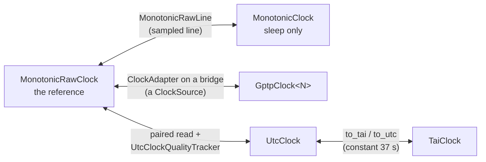

[← back to module index](README.md)

# The realtime clock API

How `statusbar/realtime/realtime_clock.hpp` models time, why it is built
that way, and how to use it. The module overview is
[REALTIME_MODULE.md](REALTIME_MODULE.md) and the project-wide rules are
in [TIME_POLICY.md](TIME_POLICY.md); this document is the long form for
the clock types themselves.

In one paragraph: every time domain is its own C++ type, one local clock
(`CLOCK_MONOTONIC_RAW`) is the reference that all the others are mapped
to and from, and each mapping reports how well it is known as a
worst-case error that grows while it is not being synchronized. Code
that uses a time decides for itself whether that error is small enough.

## Theory of operation

### Time is a measurement

A computer has oscillators, counters and an operating system that reads
them. "Now"
is a reading, and every reading carries an error: the crystal's
tolerance, its drift with temperature, the cost of the read itself. Two
clocks on one machine disagree, and they disagree by an amount that
changes. Two machines agree only as far as a protocol makes them.

So the API does three things with that fact:

1. It keeps the clocks apart, so a reading of one cannot be mistaken
   for a reading of another.
2. It picks one clock to measure with, and describes every other clock
   as a mapping to and from that one.
3. It carries the error of each mapping with the time, as a number,
   and lets the user of the time judge it.

### The domains

| Type | What it is | Used for |
|---|---|---|
| `MonotonicRawClock` | `CLOCK_MONOTONIC_RAW`: the local hardware counter, never slewed | The reference. Stamps, deadlines, intervals, measurements. |
| `MonotonicClock` | `CLOCK_MONOTONIC`: the same counter with NTP's or phc2sys's rate correction applied | Sleeping. It is the clock a sleep is made on (on Linux, the only one of the two the kernel can sleep to). |
| `GptpClock<N>` | The gPTP time of domain N, as a bridge to it maps it | Media time: presentation times, launch times. |
| `UtcClock` | The system clock (`CLOCK_REALTIME`), counted from 1970-01-01 UTC | Learning absolute time. |
| `TaiClock` | International Atomic Time, a constant 37 s from UTC | Absolute timestamps that must not see leap seconds. |

Each is an instantiation of `Clock<Tag>` and has its own `time_point`.
All of them count in one duration type, `Nanoseconds`
(`std::chrono::duration<int64_t, std::nano>`). That is deliberate: a
period is a period, and the same 125 µs is added to a gPTP schedule and
to a RAW deadline even though the two clocks tick a few ppm apart.



There is no direct path between two outer domains. A gPTP time becomes
a UTC time by going through RAW, and the errors of both mappings add.

### Why `CLOCK_MONOTONIC_RAW` is the reference

`CLOCK_MONOTONIC` looks like the natural choice and is the wrong one for
timing. On Linux, whatever disciplines the system (NTP, chrony, phc2sys)
changes its rate: by up to 500 ppm in ordinary operation, and phc2sys
can drive it far harder. An interval measured on it is wrong by the slew in force
during the interval, and a rate ratio measured against it (a gPTP
neighbour rate, a media clock recovery) has the daemon's corrections
mixed into it.

`CLOCK_MONOTONIC_RAW` is the same counter with no correction applied. It
has a rate error of its own, but a constant one, which is what a
reference needs: everything else can be fitted against it.

RAW has one drawback: the Linux kernel cannot sleep on it
(`clock_nanosleep` takes `CLOCK_MONOTONIC` and refuses
`CLOCK_MONOTONIC_RAW`). That is the only reason `MonotonicClock` exists
in this API. A deadline on RAW is reached
by converting it to a coarse `CLOCK_MONOTONIC` instant, sleeping until a
little before that, and spinning on RAW for the last stretch (see
[Reaching a RAW deadline](#reaching-a-raw-deadline)).

### What is Linux here, and what is the model

The reasons just given are the Linux kernel's: its `CLOCK_MONOTONIC` is
slewed, its sleep takes that clock and no other of the two, and (further
down) it grows the system clock's error figure at 500 ppm. Linux is
where the real-time work runs, so the model is cut to fit it.

The API itself names no operating system. On any platform
`MonotonicRawClock` is the local counter with no correction applied,
`MonotonicClock` is the clock that platform's sleep is made on, and the
rule holds: time on the first, sleep on the second. Other systems keep
their clocks differently, and that difference lives in one file,
`realtime_clock.cpp` (see [Porting](#porting)). macOS is the second
platform today: both clocks are read with `clock_gettime`, the sleep is
a relative `mach_wait_until` over the time remaining, and the system
clock's error figure comes from `ntp_gettime`. On a platform with no
unslewed counter the two reads return the same clock, the line between
them is the identity, and everything built on it still works.

### Every other clock is a mapping against RAW

A source of time (a PHC bridge, a gPTP slave) keeps a line between its
domain and RAW: a rate and an offset, fitted from paired readings. It
presents that line as the `ClockSource` concept, in bare nanoseconds,
because the source does not know which `Clock` type its domain is. A
`ClockAdapter` gives it one. From then on conversions name the clock on
both sides and cannot be crossed by accident.

### A clock is known to within a bound

"Is the clock synchronized?" is a poor question, because the answer
changes the moment one protocol message is late while the clock itself
has barely moved. The API asks a different one: how far from true can
this clock be, at this instant?

A `ClockQuality` answers it:

```
uncertainty(now) = bound_at_sync + (now - synced_at) × drift_bound_ppb / 1e9
```

- `bound_at_sync` is the worst-case error at the last synchronization
  (a read bracket, a fit residual, what the upstream clock claimed).
- `synced_at` is when that was, on RAW.
- `drift_bound_ppb` is how fast the held rate may wander afterwards.
- `epoch` identifies the timeline. It changes when the clock itself
  becomes a different clock: a new grandmaster, a step. Times before
  and after are not comparable, however small the uncertainty.
- `time_source` says where the time ultimately comes from (the IEEE
  1588 `timeSource` values).

A source that is following its master refreshes the quality at every
sync. A source that loses its master does nothing special: it goes on
converting with the rate and offset it had, and its uncertainty grows.
This is coasting. With the default 15 ppm drift bound, a clock that was
within 200 ns at its last sync is within 15.2 µs one second later and
150.2 µs ten seconds later.

A default-constructed `ClockQuality` has never synchronized and claims
nothing (`UNBOUNDED_ACCURACY`).

### The user of the time decides

A source never says it is good enough. Each user has its own tolerance
and compares. A latency meter that needs 100 µs stops measuring about
six and a half seconds into a coast at 15 ppm; a media clock that tolerates 10 ms
carries on for eleven minutes. `AccuracyLimit` is that comparison, with
a record of how the clock has kept to the limit.

Two events stay hard: a clock that has never synchronized is unbounded,
and a change of `epoch` means whatever the user built on the old
timeline (an offset, a filter) starts over.

### Told the time

A function with a latency budget is told the time by its caller and
never reads a clock. The owner of a tick reads once, and everything it
calls receives that reading as a typed `time_point`. This is why
`ClockQuality::uncertainty()`, `AccuracyLimit::judge()` and the
conversions all take the instant as an argument: they read nothing, cost
only their arithmetic, and can be tested by handing them any instant.
The rule and its forms are in [TIME_POLICY.md](TIME_POLICY.md).

### Integers only

An absolute nanosecond count never goes into a `double`. A double holds
53 bits of integer, which is 104 days of nanoseconds; a TAI timestamp
is past 2^60, where adjacent doubles are 256 ns apart. Everything in
this header is 64-bit integer arithmetic, rounded toward the safe side
and saturating: `accumulated_drift()` rounds up, bounds add without
overflow, and a bound that cannot be represented becomes
`UNBOUNDED_ACCURACY`, which is inside no limit.

## Using the API

Everything below is in namespace `statusbar::realtime`, from
`#include "statusbar/realtime/realtime.hpp"`.

### Typed times

```cpp
MonotonicRawClock::time_point const t0 = read_monotonic_raw();
do_work();
Nanoseconds const took = read_monotonic_raw() - t0;   // same clock: a duration

GptpClock0::time_point const pts = GptpClock0::from_ns(wire_timestamp_ns);
// auto wrong = pts - t0;                             // does not compile: two clocks
```

A bare integer enters a domain through `Clock::from_ns()` and leaves
through `Clock::to_ns()`, and nowhere else. Those two calls are where a
reviewer looks: each one is a statement that "this number is a time on
that clock". Wire formats, system calls and log lines are the places
they belong.

`Clock<Tag>` has no `now()`. Most of these clocks need runtime state to
be read, and the two that do not are read with `read_monotonic_raw()`
and `read_monotonic()`, so every clock read in a program has a name that
can be searched for.

### The two local clocks and the sleep

| Call | Returns |
|---|---|
| `read_monotonic_raw()` | `MonotonicRawClock::time_point`: the reference, for timing |
| `read_monotonic()` | `MonotonicClock::time_point`: for sleeping only |
| `sleep_until_monotonic(deadline)` | 0 once the deadline has passed (at once, if it already had), `EINTR` when a signal cut the sleep short, or the `errno` of a failed sleep |

The `_ns` forms beside them (`read_monotonic_raw_ns()` and so on) are
the bare counts underneath, for the few places that hold integers.

### Sources and adapters

A source provides four calls, in bare nanoseconds:

```cpp
template <typename T>
concept ClockSource = requires(T const& t, int64_t ns) {
    { t.now_ns() } -> std::convertible_to<int64_t>;       // now, in the source's domain
    { t.to_raw_ns(ns) } -> std::convertible_to<int64_t>;   // source domain -> RAW
    { t.from_raw_ns(ns) } -> std::convertible_to<int64_t>; // RAW -> source domain
    { t.is_healthy() } -> std::convertible_to<bool>;       // is the mapping valid at all
};
```

A `QualifiedClockSource` adds `quality() -> ClockQuality`. A source
without it is still a source; it claims no accuracy.

The smallest source that means something is a domain that runs at RAW's
rate a fixed offset away. Real sources (`ptpclient::PtpTimeBridge`,
`gptp::GptpTimeBridge` in statusbar-avb) keep a fitted line and present
the same four calls.

```cpp
struct OffsetSource
{
    int64_t offset_ns{0};
    ClockQuality known{};

    auto now_ns() const noexcept -> int64_t { return read_monotonic_raw_ns() + offset_ns; }
    auto to_raw_ns(int64_t ns) const noexcept -> int64_t { return ns - offset_ns; }
    auto from_raw_ns(int64_t raw_ns) const noexcept -> int64_t { return raw_ns + offset_ns; }
    auto is_healthy() const noexcept -> bool { return known.is_bounded(); }
    auto quality() const noexcept -> ClockQuality { return known; }
};

OffsetSource source{.offset_ns = 1'000'000'000, .known = ClockQuality::exact()};   // a fixed offset is known exactly
ClockAdapter<GptpClock0, OffsetSource> gptp{source};   // the source must outlive the adapter

GptpClock0::time_point const now = gptp.now();
MonotonicRawClock::time_point const wake = gptp.to_raw(now + Nanoseconds{2'000'000});
GptpClock0::time_point const back = gptp.from_raw(wake);
```

The adapter is a copyable pointer to its source. It cannot be built from
a temporary.

`MonotonicRawClockAdapter` is the adapter for the reference itself: it
reads RAW, converts by identity, is always healthy and is exact.

### Times with their accuracy

`BoundedTime<ClockT>` is a `time` and an `accuracy`: the true time is
within `time ± accuracy`. The adapter's bounded forms carry the error
through a conversion and add the mapping's own:

```cpp
BoundedTime<GptpClock0> const now = gptp.now_bounded();
BoundedTime<MonotonicRawClock> const raw = gptp.to_raw(now);  // accuracy: now's plus the mapping's

if (now.within(Nanoseconds{100'000})) {
    // good to 100 µs
}
```

`adapter.accuracy_at(raw)` is the mapping's worst-case error at a told
RAW instant. It is `UNBOUNDED_ACCURACY` for a source that reports no
quality.

Bounds only ever add. Going gPTP to RAW to UTC adds the bridge's bound
and the system clock's bound, which is the right answer: the result can
be wrong by both.

### Judging a clock

```cpp
AccuracyLimit limit{Nanoseconds{100'000}};   // this user tolerates 100 µs

// once per tick, with the tick's own RAW reading:
AccuracyVerdict const verdict = limit.judge(gptp.quality(), raw_now);
if (verdict.timeline_changed) {
    restart_my_filter();       // what was built on the old timeline does not carry over
}
if (!verdict.usable) {
    return;                    // skip this measurement; the clock is not known well enough
}
```

`judge()` is told the instant and reads no clock. `limit.record()`
gives the count of excursions, the time spent outside the limit, the
changes of timeline and the largest error seen while usable, for the
user's report. This is what a user writes in place of an
`is_synchronized()` check.

### The system clock: UTC and TAI

`read_utc()` reads the system clock as a `UtcClock` time. It is stepped
and slewed by whatever disciplines it, so it is never a timing
reference; it is how absolute time is learned, and it is related to RAW
by reading the two together.

The operating system keeps a worst-case error for its clock, which the
time daemon sets at each update. `read_system_clock_error()` returns it
(`adjtimex` on Linux, `ntp_gettime` on macOS). Between updates the
Linux kernel grows that figure at 500 ppm, which is the largest
frequency correction it can apply and far looser than a real
oscillator: one second without the time server costs 500 µs of claimed
accuracy. (`UtcClockQualityTracker::SYSTEM_GROWTH_PER_SECOND` is that
Linux figure; it is how the tracker tells the kernel's own growth from
an update by the time daemon.)

`UtcClockQualityTracker` takes the system's figure at each update as the
bound at that instant and grows it at the drift the deployment
configures:

```cpp
UtcClockQualityTracker utc_quality{
    UtcClockQualityTracker::Config{.drift_bound_ppb = 5'000, .time_source = TimeSource::gnss}};

// at the owner's sampling rate (once a second is plenty; it is a system call):
utc_quality.sample();

BoundedTime<UtcClock> const utc = utc_quality.read_bounded();
if (utc.within(Nanoseconds{3'000'000})) {
    TaiClock::time_point const tai = to_tai(utc.time);   // exact: a constant offset
}
```

A step of the system clock is a new `epoch`. The type `UtcClock` names
the timescale only: whether a local GPS receiver or a distant NTP server
disciplines the clock is `ClockQuality::time_source`, and how well it is
known is the bound.

`TAI_MINUS_UTC` is 37 s, in force since 2017. A future leap second
means changing that constant and building again.

### Reaching a RAW deadline

Linux sleeps to a `CLOCK_MONOTONIC` instant and cannot sleep to a RAW
one, so a RAW deadline is reached in two steps: a sleep to just before it, then a spin on RAW.
`MonotonicRawLine` is the published line between the two clocks
(`monotonic = rate × raw + offset`). One writer samples both clocks
through a `MonotonicRawTracker` and publishes; any thread reads without
a lock.

```cpp
MonotonicRawLine line;
MonotonicRawTracker tracker{line};
(void)tracker.sample();                      // the owner samples now and then

MonotonicRawClock::time_point const raw_now = read_monotonic_raw();
Nanoseconds const early = line.sleep_margin(deadline, raw_now) + Nanoseconds{50'000};
(void)sleep_until_monotonic(line.to_monotonic(deadline) - early);
while (read_monotonic_raw() < deadline) {
}                                            // the last stretch, on the reference
```

The line only has to be good enough that "early" really is early; the
spin does the rest. `sleep_margin()` is how much earlier to aim so that
it is: the line's misfit when last sampled plus the slew it could have
accrued since. A line that goes unsampled asks for a longer and longer
spin, so sample it (the timer does, every 100 ms by default).

You rarely write this yourself. `Timer` does it for every wake.

### With a timer

`Timer<ClockAdapterT>` keeps its schedule in the adapter's domain and
always waits and measures on RAW. Its callback is told the wake:

```cpp
using GptpAdapter = ClockAdapter<GptpClock0, OffsetSource>;

Timer<GptpAdapter> timer{
    TimerConfig{.name = "media", .period_ns = 125'000, .cpu = 3},
    [](TimerEvent<GptpClock0> const& ev, stats::AtomicWakeStats::Snapshot const&) {
        if (ev.accuracy > Nanoseconds{1'000'000}) {
            return;            // an unbounded accuracy is the largest value, so it stops here too
        }
        // ev.scheduled_time: the gPTP instant this wake was scheduled for
        // ev.wake_raw:       the RAW instant the callback was entered
        // ev.error:          how late (positive) or early the wake was
        // Tell both times down. Read no clock in here.
    },
    GptpAdapter{source}};
timer.start();
```

| `TimerEvent` field | Meaning |
|---|---|
| `scheduled_time` | The scheduled instant, on the schedule's clock |
| `error` | Wake error as a duration, positive when late |
| `wake_count` | The cycle number: the adapter's time over the period |
| `skipped_counts` | Wakes missed before this one |
| `wake_raw` | The RAW instant the callback was entered |
| `accuracy` | Worst-case accuracy of the schedule at this wake |
| `timeline` | The adapter's `ClockQuality::epoch` the grid is laid on |

A timer on a qualified adapter waits for the first bounded quality and
then keeps its schedule while the source coasts, telling each wake the
accuracy. When `timeline` differs from the wake before, the clock moved
to another timeline and the grid was laid again: `scheduled_time` and
`wake_count` are not comparable with the earlier ones.

`Timer<>` with no adapter argument schedules on RAW itself.

## Rules of use

- Time with `MonotonicRawClock`. Sleep with `MonotonicClock`. Never the
  other way round.
- Read a clock once per tick, at the owner of the tick, and tell that
  reading down as a typed `time_point`.
- `from_ns()` and `to_ns()` only at a real boundary: a wire format, a
  system call, a log line.
- Never put an absolute nanosecond count in a `double` or a `float`.
  Subtract in integers first; a short difference may be floating point.
- Compare a time with its limit through `ClockQuality::within()`,
  `BoundedTime::within()` or an `AccuracyLimit`. Do not invent a
  "synchronized" flag.
- Treat a change of `epoch` (or `TimerEvent::timeline`, or
  `AccuracyVerdict::timeline_changed`) as a different clock. Do not
  subtract across it.
- Configure the drift bound from what the deployment knows about its
  oscillator and its temperature range. 15 ppm
  (`DEFAULT_HOLDOVER_DRIFT_PPB`) is the figure when it knows nothing.
- Durations are shared across domains on purpose. A `Nanoseconds` value
  is not tied to a clock; a `time_point` is.

## Testing with made-up time

Because nothing here reads a clock unless its name says so, the whole
model runs on instants a test invents:

```cpp
ClockQuality const q{
    .synced_at = MonotonicRawClock::from_ns(1'000'000'000),
    .bound_at_sync = Nanoseconds{200},
    .epoch = 1,
    .drift_bound_ppb = 15'000,
    .time_source = TimeSource::ptp};

EXPECT_EQ(q.uncertainty(MonotonicRawClock::from_ns(2'000'000'000)), Nanoseconds{15'200});
EXPECT_TRUE(q.within(Nanoseconds{100'000}, MonotonicRawClock::from_ns(2'000'000'000)));
EXPECT_FALSE(q.within(Nanoseconds{100'000}, MonotonicRawClock::from_ns(11'000'000'000)));
```

Each tracker has a told form beside its asking one
(`MonotonicRawTracker::push()` beside `sample()`,
`UtcClockQualityTracker::observe()` beside `sample()`), and the timer's
arithmetic is `TimerSchedule`, which is told the time and has no thread.
A unit test never sleeps and never asserts how long something took.

## Porting

`realtime_clock.hpp` includes no operating-system header. The platform
is named in one file, `realtime_clock.cpp`, which implements five
functions: `read_monotonic_raw_ns()`, `read_monotonic_ns()`,
`sleep_until_monotonic_ns()`, `read_utc_ns()` and
`read_system_clock_error()`. Linux uses `clock_gettime`,
`clock_nanosleep(TIMER_ABSTIME)` and `adjtimex`; macOS uses
`clock_gettime`, `mach_wait_until` and `ntp_gettime`. Where the platform
has no absolute sleep the wait is relative, over the time remaining on
entry. Where it has no `CLOCK_MONOTONIC_RAW`, both reads return
`CLOCK_MONOTONIC`.

One platform difference shows through: across a system sleep both local
clocks keep counting on macOS and both stop on Linux. They always agree
with each other on that, which is what the line between them needs.

## Where things are

- `realtime_clock.hpp`: `Clock<Tag>` and the clock aliases,
  `Nanoseconds`, the clock reads and the sleep, `accumulated_drift()`,
  `ClockQuality`, `BoundedTime`, `ClockSource`, `ClockAdapter`,
  `MonotonicRawClockAdapter` and the concepts.
- `realtime_clock.cpp`: the platform's clock code.
- `realtime_monotonic_raw_line.hpp`: `MonotonicRawLine` and
  `MonotonicRawTracker`.
- `realtime_utc_clock.hpp`: `UtcClockQualityTracker`.
- `realtime_accuracy_limit.hpp`: `AccuracyLimit`, `AccuracyVerdict`,
  `AccuracyRecord`.
- `realtime_timer*.hpp`: `Timer`, `TimerSchedule`, `TimerEvent`.
- [REALTIME_MODULE.md](REALTIME_MODULE.md): the whole module.
- [TIME_POLICY.md](TIME_POLICY.md): which clock is for what, and the
  "told the time" rule.
